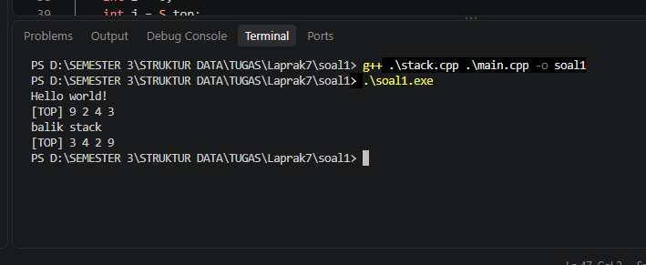
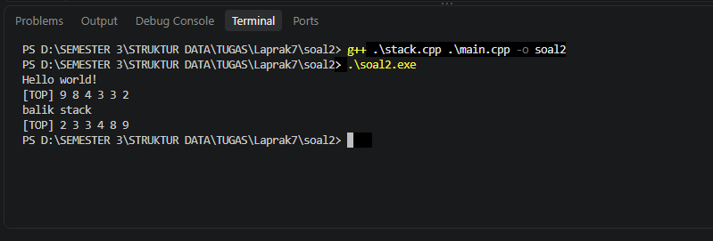
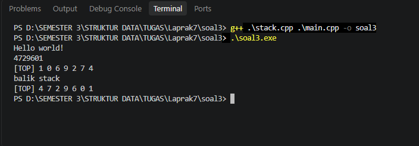

# <h1 align="center">Laporan Praktikum Modul 7 - STACK </h1>
<p align="center"> Keizya Khairunnisa - 109082500134</p>

## Dasar Teori
1. Pengertian Stack

Stack (tumpukan) adalah struktur data linear yang menggunakan prinsip LIFO (Last In First Out), yaitu elemen yang terakhir dimasukkan akan menjadi elemen yang pertama kali diambil. Seluruh akses hanya dilakukan lewat satu ujung yang disebut TOP.

2. Operasi Dasar

Push: menambahkan elemen ke posisi paling atas stack (Top bertambah satu).
Pop: mengambil elemen paling atas stack (Top berkurang satu).

Keduanya hanya menyentuh elemen teratas, jadi waktunya konstan, O(1).

3. Primitif Stack

createStack() untuk membuat stack kosong, isEmpty() untuk mengecek stack kosong, push(), pop(), dan printInfo() untuk menampilkan isi stack.

4. Representasi Stack

Pointer: elemen berupa node yang saling terhubung, ukurannya dinamis.
Tabel (array): elemen disimpan dalam array berkapasitas tetap dengan satu variabel Top. Pada praktikum ini dipakai array info[20]. Jika stack penuh lalu di-push terjadi overflow, dan jika stack kosong lalu di-pop terjadi underflow.

5. Operasi Tambahan Praktikum

balikStack: membalik urutan isi stack dengan menukar elemen paling bawah dan paling atas hingga ke tengah.
pushAscending: menyisipkan elemen sambil menjaga isi stack tetap terurut, dengan menggeser elemen yang lebih besar ke atas.
getInputStream: membaca input dengan cin.get() sampai Enter, lalu memasukkan tiap angka ke stack.

6. Penerapan

Fitur undo/redo, pemanggilan fungsi (call stack), pengecekan kurung seimbang, dan evaluasi ekspresi postfix.


## Guided 1 stack.h

source code guided 1
```C++
/* file : stack.h
   contoh ADT stack dengan representasi tabel */
#ifndef STACK_H_INCLUDED
#define STACK_H_INCLUDED

#include <iostream>
using namespace std;

struct infotype {
    char nim[20];
    char nama[20];
};
struct Stack {
    infotype info[10];
    int Top;
};

/* prototype */
/******** pengecekan apakah Stack kosong *********/
int isEmpty(Stack S);
/* mengembalikan nilai 0 jika stack kosong */

/******** pembuatan Stack ********/
void createStack(Stack &S);
/* I.S. sembarang
   F.S. terbentuk stack dengan Top=0 */

/******** penambahan elemen pada Stack ********/
void push(Stack &S, infotype X);
/* I.S. Stack mungkin kosong
   F.S. menambahkan elemen pada stack dengan nilai X, TOP=TOP+1 */

/******** penghapusan elemen pada Stack ********/
void pop(Stack &S, infotype &X);
/* I.S. stack tidak kosong
   F.S. nilai info pada indeks TOP disimpan pada X, kemudian TOP=TOP-1 */

/******** proses semua elemen Stack *********/
void viewStack(Stack S);
/* I.S. stack mungkin kosong
   F.S. jika stack tidak kosong menampilkan semua info yang ada pada stack
*/
#endif // STACK_H_INCLUDED
```

penjelasan guided 1

Program ini berisi deklarasi ADT Stack dengan representasi tabel. infotype menyimpan nim dan nama, sedangkan Stack berisi array info untuk 10 data dan variabel Top. File ini juga memuat prototype isEmpty, createStack, push, pop, dan viewStack

## Guided 2 stack.cpp

source code guided 2
```C++  
#include "stack.h"

int isEmpty(Stack S) {
    /* Top = 0 berarti kosong, sesuai komentar di stack.h dikembalikan 0 */
    if (S.Top == 0) {
        return 0;
    } else {
        return 1;
    }
}

void createStack(Stack &S) {
    S.Top = 0;
}

void push(Stack &S, infotype X) {
    if (S.Top < 10) {
        S.Top = S.Top + 1;
        S.info[S.Top - 1] = X;   /* Top 1..10 dipetakan ke indeks array 0..9 */
    } else {
        cout << "Stack penuh, data tidak bisa ditambahkan" << endl;
    }
}

void pop(Stack &S, infotype &X) {
    if (isEmpty(S) != 0) {
        X = S.info[S.Top - 1];
        S.Top = S.Top - 1;
    } else {
        cout << "Stack kosong, tidak ada data yang bisa diambil" << endl;
    }
}

void viewStack(Stack S) {
    if (isEmpty(S) == 0) {
        cout << "Stack kosong" << endl;
    } else {
        cout << "Isi stack (dari TOP):" << endl;
        for (int i = S.Top; i >= 1; i--) {
            cout << i << ". " << S.info[i - 1].nim << " - "
                 << S.info[i - 1].nama << endl;
        }
    }
}
```

penjelasan guided 2

Program ini berisi isi dari fungsi-fungsi stack. createStack mengisi Top = 0 sebagai tanda stack kosong. isEmpty mengembalikan 0 kalau stack kosong, sesuai komentar di modul. push menaikkan Top lalu menyimpan data di info[Top - 1] kalau stack belum penuh. pop mengambil data di info[Top - 1] ke parameter X lalu menurunkan Top, kalau stack tidak kosong. viewStack menampilkan isi stack dari atas ke bawah, atau tulisan “Stack kosong” kalau tidak ada isinya.


## Guided 3 main.cpp

source code guided 3
```C++
#include <iostream>
#include <cstring>
#include "stack.h"
using namespace std;

int main() {
    Stack S;
    infotype data, hasil;

    createStack(S);
    cout << "Stack baru dibuat, Top = " << S.Top << endl;
    viewStack(S);

    cout << endl << "--- Push 3 data ---" << endl;
    strcpy(data.nim, "103112400001");
    strcpy(data.nama, "Andi");
    push(S, data);

    strcpy(data.nim, "103112400002");
    strcpy(data.nama, "Budi");
    push(S, data);

    strcpy(data.nim, "103112400003");
    strcpy(data.nama, "Citra");
    push(S, data);
    viewStack(S);

    cout << endl << "--- Pop 1 data ---" << endl;
    pop(S, hasil);
    cout << "Data yang diambil: " << hasil.nim << " - " << hasil.nama << endl;
    viewStack(S);

    cout << endl << "--- Pop sampai kosong ---" << endl;
    pop(S, hasil);
    pop(S, hasil);
    pop(S, hasil);
    viewStack(S);

    return 0;
}
```

penjelasan guided 3

Program ini mencoba semua fungsi stack. Stack dibuat dan ditampilkan dalam keadaan kosong, lalu tiga data (Andi, Budi, Citra) dimasukkan dengan push. Setelah itu satu data diambil dengan pop (Citra) dan isi stack ditampilkan lagi. Terakhir pop dipanggil tiga kali sampai stack kosong. Pada pemanggilan ketiga stack sudah kosong, jadi muncul pesan bahwa tidak ada data yang bisa diambil.


## Unguided 

### 1. Buatlah ADT Stack menggunakan ARRAY sebagai berikut di dalam file “stack.h”:
```text
Type infotype : integer
Type Stack <
    info : array [20] of integer
    top : integer
>

procedure CreateStack( input/output S : Stack )
procedure push(input/output S : Stack, input x : infotype)
function pop(input/output t S : Stack ) → infotype
procedure printInfo( input S : Stack )
procedure balikStack(input/output S : Stack )
```
  
source code unguided soal 1
#### stack.h
```C++
#ifndef STACK_H_INCLUDED
#define STACK_H_INCLUDED

#include <iostream>
using namespace std;

typedef int infotype;

struct Stack {
    infotype info[20];
    int top;
};

void createStack(Stack &S);
void push(Stack &S, infotype x);
infotype pop(Stack &S);
void printInfo(Stack S);
void balikStack(Stack &S);

#endif // STACK_H_INCLUDED
```

#### stack.cpp
```C++
#include "stack.h"

void createStack(Stack &S) {
    // top = -1 artinya stack masih kosong
    S.top = -1;
}

void push(Stack &S, infotype x) {
    if (S.top < 19) {
        S.top++;
        S.info[S.top] = x;
    } else {
        cout << "Stack penuh" << endl;
    }
}

infotype pop(Stack &S) {
    infotype x = -1;
    if (S.top >= 0) {
        x = S.info[S.top];
        S.top--;
    } else {
        cout << "Stack kosong" << endl;
    }
    return x;
}

void printInfo(Stack S) {
    cout << "[TOP] ";
    for (int i = S.top; i >= 0; i--) {
        cout << S.info[i] << " ";
    }
    cout << endl;
}

void balikStack(Stack &S) {
    // tukar isi dari ujung bawah dengan ujung atas
    int i = 0;
    int j = S.top;
    while (i < j) {
        infotype temp = S.info[i];
        S.info[i] = S.info[j];
        S.info[j] = temp;
        i++;
        j--;
    }
}
```

#### main.cpp
```C++
#include <iostream>
#include "stack.h"
using namespace std;

int main()
{
    cout << "Hello world!" << endl;
    Stack S;
    createStack(S);
    push(S, 3);
    push(S, 4);
    push(S, 8);
    pop(S);
    push(S, 2);
    push(S, 3);
    pop(S);
    push(S, 9);
    printInfo(S);
    cout << "balik stack" << endl;
    balikStack(S);
    printInfo(S);
    return 0;
}
```

### Output Unguided soal 1 :




penjelasan unguided 1

Program ini membuat ADT Stack dengan array berukuran 20 dan variabel top untuk menunjuk elemen paling atas. Di createStack, top diisi -1 supaya stack dianggap kosong. push menaikkan top lalu menyimpan nilai di posisi itu, sedangkan pop mengambil nilai di posisi top lalu menurunkan top. printInfo mencetak isi stack dari atas ke bawah, dan balikStack menukar isi yang paling bawah dengan yang paling atas sampai ketemu di tengah. Hasilnya [TOP] 9 2 4 3, lalu setelah dibalik jadi [TOP] 3 4 2 9.

### 2. Tambahkan prosedur pushAscending( in/out S : Stack, in x : integer)

```C++
int main()
{
    cout << "Hello world!" << endl;
    Stack S;
    createStack(S);
    pushAscending(S,3);
    pushAscending(S,4);
    pushAscending(S,8);
    pushAscending(S,2);
    pushAscending(S,3);
    pushAscending(S,9);
    printInfo(S);
    cout<<"balik stack"<<endl;
    balikStack(S);
    printInfo(S);
    return 0;
}
```

source code unguided 2
#### stack.h
```C++
#ifndef STACK_H_INCLUDED
#define STACK_H_INCLUDED

#include <iostream>
using namespace std;

typedef int infotype;

struct Stack {
    infotype info[20];
    int top;
};

void createStack(Stack &S);
void push(Stack &S, infotype x);
infotype pop(Stack &S);
void printInfo(Stack S);
void balikStack(Stack &S);

// TAMBAHAN SESUAI SOAL 2: prosedur push ascending
void pushAscending(Stack &S, infotype x);

#endif // STACK_H_INCLUDED
```

#### stack.cpp
```C++
#include "stack.h"

void createStack(Stack &S) {
    // top = -1 artinya stack masih kosong
    S.top = -1;
}

void push(Stack &S, infotype x) {
    if (S.top < 19) {
        S.top++;
        S.info[S.top] = x;
    } else {
        cout << "Stack penuh" << endl;
    }
}

infotype pop(Stack &S) {
    infotype x = -1;
    if (S.top >= 0) {
        x = S.info[S.top];
        S.top--;
    } else {
        cout << "Stack kosong" << endl;
    }
    return x;
}

void printInfo(Stack S) {
    cout << "[TOP] ";
    for (int i = S.top; i >= 0; i--) {
        cout << S.info[i] << " ";
    }
    cout << endl;
}

void balikStack(Stack &S) {
    // tukar isi dari ujung bawah dengan ujung atas
    int i = 0;
    int j = S.top;
    while (i < j) {
        infotype temp = S.info[i];
        S.info[i] = S.info[j];
        S.info[j] = temp;
        i++;
        j--;
    }
}

// TAMBAHAN SESUAI SOAL 2: push tapi isi stack tetap terurut
void pushAscending(Stack &S, infotype x) {
    if (S.top < 19) {
        // geser elemen yang lebih besar dari x ke atas dulu
        int i = S.top;
        while (i >= 0 && S.info[i] > x) {
            S.info[i + 1] = S.info[i];
            i--;
        }
        // taruh x di posisi yang kosong
        S.info[i + 1] = x;
        S.top++;
    } else {
        cout << "Stack penuh" << endl;
    }
}
```

#### main.cpp
```C++
  #include <iostream>
#include "stack.h"
using namespace std;

int main()
{
    cout << "Hello world!" << endl;
    Stack S;
    createStack(S);
    // PERUBAHAN SESUAI SOAL 2: push diganti pushAscending
    pushAscending(S, 3);
    pushAscending(S, 4);
    pushAscending(S, 8);
    pushAscending(S, 2);
    pushAscending(S, 3);
    pushAscending(S, 9);
    printInfo(S);
    cout << "balik stack" << endl;
    balikStack(S);
    printInfo(S);
    return 0;
}
```

### Output Unguided 2 :



penjelasan unguided 2

Program ini menambah prosedur pushAscending yang cara kerjanya seperti push, tapi isi stack harus tetap terurut. Elemen yang lebih besar dari angka baru digeser ke atas satu per satu, lalu angka baru ditaruh di tempat yang kosong. Jadi walaupun angkanya dimasukkan acak (3, 4, 8, 2, 3, 9), isi stack tetap urut, dengan angka terbesar di TOP. Hasilnya [TOP] 9 8 4 3 3 2, lalu setelah dibalik jadi [TOP] 2 3 3 4 8 9.

## 3. Tambahkan prosedur getInputStream( in/out S : Stack ). Prosedur akan terus membaca dan menerima input user dan memasukkan setiap input ke dalam stack hingga user menekan tombol enter. Contoh: gunakan cin.get() untuk mendapatkan inputan user.
```C++
int main()
{
    cout << "Hello world!" << endl;
    Stack S;
    createStack(S);
    getInputStream(S);
    printInfo(S);
    cout<<"balik stack"<<endl;
    balikStack(S);
    printInfo(S);
    return 0;
}
```

source code unguided 3
#### stack.h
```C++
#ifndef STACK_H_INCLUDED
#define STACK_H_INCLUDED

#include <iostream>
using namespace std;

typedef int infotype;

struct Stack {
    infotype info[20];
    int top;
};

void createStack(Stack &S);
void push(Stack &S, infotype x);
infotype pop(Stack &S);
void printInfo(Stack S);
void balikStack(Stack &S);

// TAMBAHAN SESUAI SOAL 3: prosedur baca input dari user
void getInputStream(Stack &S);

#endif // STACK_H_INCLUDED
```

#### stack.cpp
```C++
#include "stack.h"

void createStack(Stack &S) {
    // top = -1 artinya stack masih kosong
    S.top = -1;
}

void push(Stack &S, infotype x) {
    if (S.top < 19) {
        S.top++;
        S.info[S.top] = x;
    } else {
        cout << "Stack penuh" << endl;
    }
}

infotype pop(Stack &S) {
    infotype x = -1;
    if (S.top >= 0) {
        x = S.info[S.top];
        S.top--;
    } else {
        cout << "Stack kosong" << endl;
    }
    return x;
}

void printInfo(Stack S) {
    cout << "[TOP] ";
    for (int i = S.top; i >= 0; i--) {
        cout << S.info[i] << " ";
    }
    cout << endl;
}

void balikStack(Stack &S) {
    // tukar isi dari ujung bawah dengan ujung atas
    int i = 0;
    int j = S.top;
    while (i < j) {
        infotype temp = S.info[i];
        S.info[i] = S.info[j];
        S.info[j] = temp;
        i++;
        j--;
    }
}

// TAMBAHAN SESUAI SOAL 3: baca input user sampai enter, tiap angka di-push
void getInputStream(Stack &S) {
    char c;
    c = cin.get();
    while (c != '\n') {
        push(S, c - '0'); // char angka diubah jadi integer
        c = cin.get();
    }
}
```

#### main.cpp
```C++
  #include <iostream>
#include "stack.h"
using namespace std;

int main()
{
    cout << "Hello world!" << endl;
    Stack S;
    createStack(S);
    // PERUBAHAN SESUAI SOAL 3: isi stack dari input user, bukan push manual
    getInputStream(S);
    printInfo(S);
    cout << "balik stack" << endl;
    balikStack(S);
    printInfo(S);
    return 0;
}
```

### Output Unguided 3 :



penjelasan unguided 3

Program ini menambah prosedur getInputStream supaya isi stack datang dari ketikan user, bukan ditulis manual di main. Prosedurnya membaca satu karakter dengan cin.get(), mengubahnya jadi angka dengan c - '0', lalu memasukkannya ke stack. Ini diulang terus sampai user menekan Enter. Dengan input 4729601, hasilnya [TOP] 1 0 6 9 2 7 4, lalu setelah dibalik jadi [TOP] 4 7 2 9 6 0 1, sama dengan contoh di modul.

## Kesimpulan
Di praktikum ini saya membuat stack pakai array di C++. Stack itu cara kerjanya LIFO, jadi data yang masuk paling akhir yang keluar duluan, dan semuanya lewat satu ujung saja yaitu top. Dari situ saya bikin createStack, push, pop, printInfo, dan balikStack.

Setelah itu saya tambah dua prosedur lagi. pushAscending bikin isi stack selalu urut, caranya angka yang lebih besar digeser ke atas dulu baru angka baru dimasukkan. getInputStream bikin stack bisa diisi dari ketikan kita sendiri sampai tekan Enter. Waktu saya jalankan, hasilnya sama dengan contoh di modul.

## Referensi
[1] Modul Praktikum Struktur Data, “Modul 7: Stack,” hlm. 59–65.

[2] GeeksforGeeks, “Introduction to Stack Data Structure,” GeeksforGeeks. https://www.geeksforgeeks.org/dsa/introduction-to-stack-data-structure-and-algorithm-tutorials/

[3] Programiz, “Stack Data Structure and Implementation in Python, Java and C/C++,” Programiz. https://www.programiz.com/dsa/stack