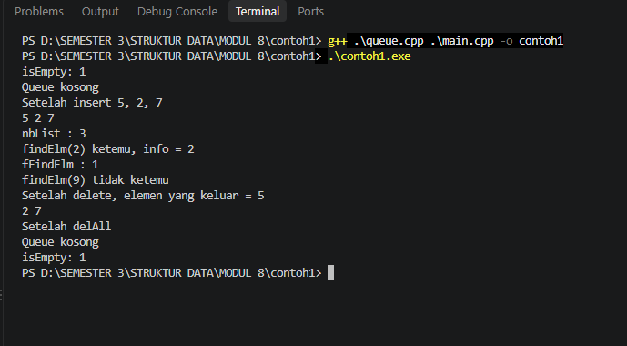
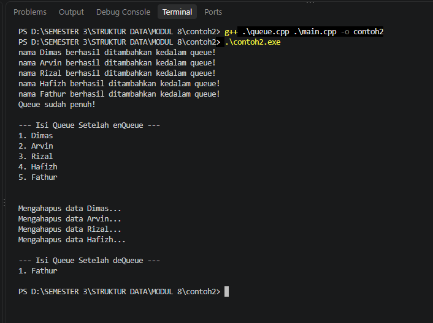
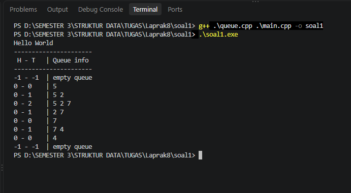
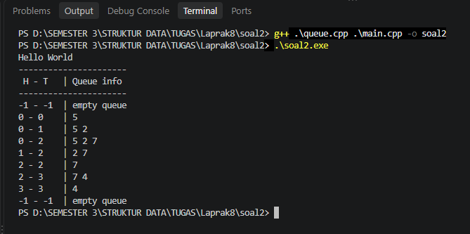
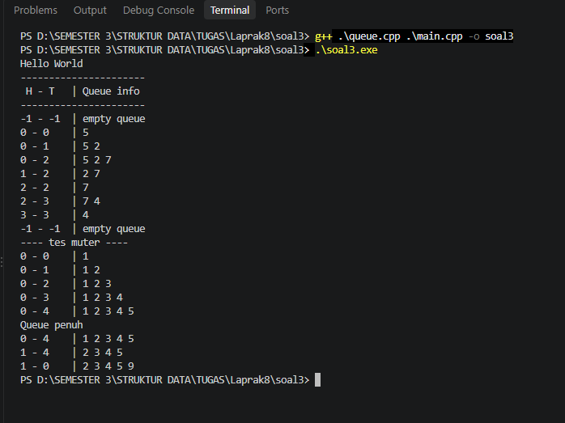

# <h1 align="center">Laporan Praktikum Modul 8 -  QUEUE </h1>
<p align="center"> Keizya Khairunnisa - 109082500134</p>

## Dasar Teori

### 1. Pengertian Queue

Queue adalah struktur data yang cara kerjanya mirip antrean di dunia nyata, misalnya antrean membeli tiket kereta api. Orang yang datang paling awal akan dilayani terlebih dahulu, sedangkan orang yang datang terakhir akan dilayani paling akhir. Prinsip ini disebut **FIFO (First In First Out)**, yaitu data yang pertama masuk akan menjadi data yang pertama keluar.

Berbeda dengan stack yang proses masuk dan keluarnya melalui satu ujung (LIFO), queue memiliki dua ujung:

- **Head (front):** ujung depan, tempat elemen diambil atau dihapus.
- **Tail (rear):** ujung belakang, tempat elemen baru dimasukkan.

Queue dapat diimplementasikan menggunakan **linked list** maupun **array (tabel)**.

### 2. Operasi pada Queue

Operasi utama pada queue terdiri dari dua macam:

1. **Enqueue (insert):** menambahkan elemen baru di bagian belakang (tail).
2. **Dequeue (delete):** mengambil dan menghapus elemen dari bagian depan (head).

Selain itu, terdapat beberapa operasi pendukung, yaitu:

- `createQueue`: membuat queue kosong.
- `isEmpty`: memeriksa apakah queue kosong.
- `isFull`: memeriksa apakah queue penuh (khusus representasi array).
- `printInfo`: menampilkan seluruh isi queue.

### 3. Queue dengan Linked List

Pada linked list, setiap elemen berupa node yang memiliki `info` (data) dan `next` (pointer ke elemen berikutnya). Queue menggunakan dua pointer, yaitu `head` dan `tail`. Queue dikatakan kosong apabila `head = Nil`.

**Enqueue** dilakukan dengan menghubungkan elemen baru ke bagian `next` dari tail, kemudian tail dipindahkan ke elemen baru.

Contoh kode:

```c++
(Q.tail)->next = P;
Q.tail = P;
```

**Dequeue** dilakukan dengan mengambil elemen yang berada di head, kemudian head dipindahkan ke elemen berikutnya.

Contoh kode:

```c++
P = Q.head;
Q.head = P->next;
P->next = Nil;
```

Kelebihan linked list adalah jumlah elemennya tidak dibatasi oleh ukuran array, selama memori masih tersedia. Namun, penggunaan linked list membutuhkan pengaturan alokasi dan dealokasi memori.

### 4. Queue dengan Array (Representasi Tabel)

Jika menggunakan array, jumlah elemen dibatasi oleh ukuran array (`MAX`) dan tidak memerlukan pengelolaan memori secara manual. Terdapat tiga alternatif untuk mengatur posisi head dan tail.

a. Alternatif 1: Head Diam, Tail Bergerak

Head selalu berada di indeks pertama selama queue tidak kosong, sedangkan tail bergerak ketika ada penambahan elemen.

Saat terjadi dequeue, seluruh elemen harus digeser ke depan agar head tetap berada di posisi awal. Cara ini mudah dipahami, tetapi kurang efisien karena membutuhkan proses pergeseran elemen.

b. Alternatif 2: Head Bergerak, Tail Bergerak

Pada alternatif ini, head dan tail sama-sama dapat bergerak. Ketika terjadi dequeue, head cukup maju satu indeks sehingga tidak perlu menggeser seluruh elemen.

Cara ini lebih efisien dibandingkan alternatif pertama. Namun, dapat terjadi kondisi **penuh semu**, yaitu ketika tail sudah berada di indeks terakhir, padahal masih terdapat ruang kosong di bagian depan array akibat elemen yang sudah dihapus.

Untuk mengatasi kondisi tersebut, elemen perlu digeser ke depan ketika tail sudah mencapai indeks maksimum dan ruang di bagian belakang tidak tersedia.

c. Alternatif 3: Head dan Tail Berputar (Circular Queue)

Pada alternatif ini, head dan tail bergerak secara melingkar mengelilingi array. Jika tail sudah mencapai indeks terakhir dan masih terdapat ruang kosong di bagian depan, tail akan kembali ke indeks awal.

Perpindahan posisi dapat dihitung menggunakan operasi modulo:

```c++
tail = (tail + 1) % MAX;
head = (head + 1) % MAX;
```

Cara ini tidak membutuhkan pergeseran elemen dan dapat memanfaatkan ruang kosong pada array dengan lebih efisien. Queue dianggap penuh jika:

```c++
(tail + 1) % MAX == head;
```

Karena bentuknya melingkar, metode ini juga dikenal dengan istilah **circular buffer**.

### 5. Perbandingan Ketiga Alternatif

| Keterangan | Alternatif 1 | Alternatif 2 | Alternatif 3 |
|---|---|---|---|
| Head | Diam di indeks awal | Bergerak | Bergerak, berputar |
| Tail | Bergerak | Bergerak | Bergerak, berputar |
| Dequeue | Geser semua elemen, O(n) | Head maju saja, O(1) | Head maju saja, O(1) |
| Enqueue | O(1) | O(1), kadang O(n) jika harus geser | O(1) |
| Penuh semu | Tidak ada | Ada | Tidak ada |
| Efisiensi | Rendah | Sedang | Tinggi |

### 6. Penerapan Queue

Queue banyak digunakan dalam bidang komputer untuk mengatur proses yang membutuhkan sistem antrean. Beberapa contoh penerapannya adalah:

- **Print Spooler:** mengatur antrean dokumen yang akan dicetak oleh printer.
- **CPU Scheduling:** mengatur urutan proses yang akan dijalankan oleh sistem operasi.
- **Buffer Data:** menampung sementara data dari keyboard maupun jaringan sebelum diproses.
- **Breadth-First Search (BFS):** digunakan dalam algoritma penelusuran graf untuk mengunjungi simpul berdasarkan tingkat kedekatannya.


## Guided 1 

#### queue.h
source code 
```C++
#ifndef QUEUE_H_INCLUDE
#define QUEUE_H_INCLUDE

#include <iostream>
using namespace std;

#define Nil NULL

typedef bool boolean;
typedef int infotype;
typedef struct elmQ *address;

struct elmQ {
    infotype info;
    address next;
};

struct queue {
    address head, tail;
};

boolean isEmpty(queue Q);
void CreateQueue(queue &Q);
address alokasi(infotype X);
void dealokasi(address P);
address findElm(queue Q, infotype X);
boolean fFindElm(queue Q, address P);
void insert(queue &Q, address P);
void deleteQueue(queue &Q, address &P);
void printInfo(queue Q);
int nbList(queue Q);
void delAll(queue &Q);

#endif 
```

#### queue.cpp
source code 
```C++  
#include "queue.h"

boolean isEmpty(queue Q) {
    return (Q.head == Nil);
}

void CreateQueue(queue &Q) {
    Q.head = Nil;
    Q.tail = Nil;
}

address alokasi(infotype X) {
    address P = new (nothrow) elmQ;
    if (P != Nil) {
        P->info = X;
        P->next = Nil;
    }
    return P;
}

void dealokasi(address P) {
    delete P;
}

address findElm(queue Q, infotype X) {
    address P = Q.head;
    while (P != Nil) {
        if (P->info == X) {
            return P;
        }
        P = P->next;
    }
    return Nil;
}

boolean fFindElm(queue Q, address P) {
    address R = Q.head;
    while (R != Nil) {
        if (R == P) {
            return true;
        }
        R = R->next;
    }
    return false;
}

void insert(queue &Q, address P) {
    if (isEmpty(Q)) {
        Q.head = P;
        Q.tail = P;
    } else {
        (Q.tail)->next = P;
        Q.tail = P;
    }
}

void deleteQueue(queue &Q, address &P) {
    P = Q.head;
    if (Q.head == Q.tail) {
        Q.head = Nil;
        Q.tail = Nil;
    } else {
        Q.head = P->next;
    }
    P->next = Nil;
}

void printInfo(queue Q) {
    if (isEmpty(Q)) {
        cout << "Queue kosong" << endl;
    } else {
        address P = Q.head;
        while (P != Nil) {
            cout << P->info << " ";
            P = P->next;
        }
        cout << endl;
    }
}

int nbList(queue Q) {
    int jumlah = 0;
    address P = Q.head;
    while (P != Nil) {
        jumlah++;
        P = P->next;
    }
    return jumlah;
}

void delAll(queue &Q) {
    address P;
    while (!isEmpty(Q)) {
        deleteQueue(Q, P);
        dealokasi(P);
    }
}
```

#### main.cpp
source code 
```C++
#include <iostream>
#include "queue.h"
using namespace std;

int main() {
    queue Q;
    address P;

    CreateQueue(Q);
    cout << "isEmpty: " << isEmpty(Q) << endl;
    printInfo(Q);

    insert(Q, alokasi(5));
    insert(Q, alokasi(2));
    insert(Q, alokasi(7));
    cout << "Setelah insert 5, 2, 7" << endl;
    printInfo(Q);
    cout << "nbList : " << nbList(Q) << endl;

    P = findElm(Q, 2);
    if (P != Nil) {
        cout << "findElm(2) ketemu, info = " << P->info << endl;
        cout << "fFindElm : " << fFindElm(Q, P) << endl;
    }
    if (findElm(Q, 9) == Nil) {
        cout << "findElm(9) tidak ketemu" << endl;
    }

    deleteQueue(Q, P);
    cout << "Setelah delete, elemen yang keluar = " << P->info << endl;
    dealokasi(P);
    printInfo(Q);

    delAll(Q);
    cout << "Setelah delAll" << endl;
    printInfo(Q);
    cout << "isEmpty: " << isEmpty(Q) << endl;

    return 0;
}
```

### Output guided 1 :



penjelasan guided 1

Program ini bikin queue pakai linked list, jadi ukurannya ga terbatas. Tiap elemen punya info (data) dan next (penunjuk ke elemen berikutnya), dan queue nyimpen head (depan) dan tail (belakang), dengan kondisi kosong kalau head == Nil. insert masang elemen baru di belakang lewat tail, sedangkan deleteQueue ngambil elemen di depan lewat head lalu head dimajuin (FIFO). Sisanya fungsi pendukung: alokasi dan dealokasi buat bikin dan hapus elemen, findElm dan fFindElm buat nyari elemen, printInfo buat nampilin isi, nbList buat ngitung jumlah elemen, dan delAll buat ngosongin queue. Di main.cpp, queue diisi 5, 2, 7, dicari elemen 2 (ketemu) dan 9 (ga ketemu), lalu 5 dihapus karena masuk duluan, dan terakhir semuanya dikosongin pakai delAll.


## Guided 2 

#### queue.h
source code 
```C++
#ifndef QUEUE_H
#define QUEUE_H

#include <iostream>
using namespace std;

const int MAKSIMAL = 5;

struct queue {
    string nama[MAKSIMAL];
    int head;
    int tail;
};

bool isFull(queue Q);
bool isEmpty(queue Q);
void CreateQueue(queue &Q);
void enQueue(queue &Q, string nama);
void deQueue(queue &Q);
void viewQueue(queue Q);

#endif  
```

#### queue.cpp
source code 
```C++  
#include "queue.h"
#include <iostream>

using namespace std;

// NOTE : 
// Implementasi 1 = head diam, tail bergerak (Queue Linear Statis, kerana head nya tetap diam)
// Implementasi 2 = head bergerak, tail bergerak (Queue Linear Dinamis, karena head & tail nya sama-sama bergerak)
// Implementasi 3 = head dan tail berputar (Queue Circular, karena jika udh mentok tapi masih ada space, diputar sehingga tail bisa ada didepan head)

bool isEmpty(queue Q){
    if(Q.head == -1 && Q.tail == -1){
        return true;
    } else {
        return false;
    }
}

//isFull implmenetasi 1 & 2
bool isFull(queue Q){
    if(Q.tail == MAKSIMAL - 1){
        return true;
    } else {
        return false;
    }
}

// //isFull implementasi 3
// bool isFull(queue Q){
//     if((Q.tail + 1) % MAKSIMAL == Q.head){
//         return true;
//     } else {
//         return false;
//     }
// }

void CreateQueue(queue &Q){ //terbentuk queue dengan head = -1 dan tail = -1 
    Q.head = -1;
    Q.tail = -1;
}
 

//enqueue implementasi 1 & 2
void enQueue(queue &Q, string nama){
    if(isFull(Q) == true){
        cout << "Queue sudah penuh!" << endl;
    } else {
        if(isEmpty(Q) == true){
            Q.head = Q.tail = 0;
        } else {
            Q.tail++;
        }
        Q.nama[Q.tail] = nama;
        cout << "nama " << nama << " berhasil ditambahkan kedalam queue!" << endl;
    }
}

// //enQueue implementasi 3
// void enQueue(queue &Q, string nama){
//     if(isFull(Q) == true){
//         cout << "Queue sudah penuh!" << endl;
//     } else {
//         if(isEmpty(Q) == true){
//             Q.head = Q.tail = 0;
//         } else {
//             Q.tail = (Q.tail + 1) % MAKSIMAL; // bergerak melingkar
//         }
//         Q.nama[Q.tail] = nama;
//         cout << "nama " << nama << " berhasil ditambahkan kedalam queue!" << endl;
//     }
// }

//dequeue implementasi 1
void deQueue(queue &Q){
    if(isEmpty(Q) == true){
        cout << "Queue kosong!" << endl;
    } else {
        cout << "Mengahapus data " << Q.nama[Q.head] << "..." << endl;
        for(int i = 0; i < Q.tail; i++){
            Q.nama[i] =  Q.nama[i+1];
        }
        Q.tail--;
        if(Q.tail < 0){ //kalo semua isi queue nya udh dikelaurin, set head & tail ke -1
            Q.head = -1;
            Q.tail = -1;
        }
    }
}

// //dequeue implementasi 2
// void deQueue(queue &Q){
//     if(isEmpty(Q) == true){
//         cout << "Queue kosong!" << endl;
//     } else {
//         cout << "Mengahapus data " << Q.nama[Q.head] << "..." << endl;
//         Q.head++;
//         if(Q.head > Q.tail){ //kalo elemennya udh abis (head akan lebih 1 dari tail), maka reset ulang head & tail ke -1
//             Q.head = -1;
//             Q.tail = -1;
//         }
//     }
// }

// //deQueue implementasi 3
// void deQueue(queue &Q){
//     if(isEmpty(Q) == true){
//         cout << "Queue kosong!" << endl;
//     } else {
//         cout << "Mengahapus data " << Q.nama[Q.head] << "..." << endl;
//         if(Q.head == Q.tail){ //kalo elemennya tinggal 1, langsungkan saja head & tail nya reset ke -1
//             Q.head = -1;
//             Q.tail = -1;
//         } else {
//             Q.head = (Q.head + 1) % MAKSIMAL; // bergerak melingkar
//         }
//     }
// }

//viewQueue implementasi 1 & 2
void viewQueue(queue Q){
    if(isEmpty(Q) == true){
        cout << "Queue kosong!" << endl;
    } else {
        for(int i = Q.head; i <= Q.tail; i++){
            cout << i -  Q.head + 1 << ". " << Q.nama[i] << endl;
        }
    }
    cout << endl;
}

// //viewQueue implementasi 3
// void viewQueue(queue Q){
//     if(isEmpty(Q) == true){
//         cout << "Queue kosong!" << endl;
//     } else {
//         int i = Q.head;
//         int count = 1;
//         while(true){
//             cout << count << ". " << Q.nama[i] << endl;
//             if(i == Q.tail){
//                 break;
//             }
//             i = (i + 1) % MAKSIMAL;
//             count++;
//         }   
//     }
// }
``` 

#### main.cpp
source code 
```C++
#include "queue.h"
#include <iostream>

using namespace std;

int main(){
    queue Q;

    CreateQueue(Q);
    enQueue(Q, "Dimas");
    enQueue(Q, "Arvin");
    enQueue(Q, "Rizal");
    enQueue(Q, "Hafizh");
    enQueue(Q, "Fathur");
    enQueue(Q, "Daffa");
    cout << endl;

    cout << "--- Isi Queue Setelah enQueue ---" << endl;
    viewQueue(Q);
    cout << endl;

    deQueue(Q);
    deQueue(Q);
    deQueue(Q);
    deQueue(Q);
    // deQueue(Q);
    // deQueue(Q);
    cout << endl;

    cout << "--- Isi Queue Setelah deQueue ---" << endl;
    viewQueue(Q);

    return 0;
}
```

### Output guided 2 :



penjelasan guided 2

Program ini bikin queue pakai array string `nama` berukuran 5 dengan `head` sebagai posisi depan dan `tail` sebagai posisi belakang, di mana queue kosong kalau keduanya -1. Di `queue.cpp` ada tiga implementasi sekaligus yang tinggal di-comment atau dibuka sesuai yang mau dipakai. Implementasi 1 (head diam) ngegeser semua elemen ke kiri tiap `deQueue`, implementasi 2 (head dan tail bergerak) cukup nambah `head` tanpa geser elemen, dan implementasi 3 (circular) pakai `% MAKSIMAL` supaya `head` dan `tail` balik ke index 0 kalau sudah mentok. Di `main.cpp`, enam nama di-enqueue tapi nama keenam (Daffa) ditolak karena kapasitasnya cuma 5, lalu empat kali `deQueue` ngeluarin Dimas, Arvin, Rizal, dan Hafizh sesuai urutan masuk (FIFO), jadi yang tersisa tinggal Fathur.

## Unguided 

### 1. Buatlah ADT Queue menggunakan ARRAY sebagai berikut di dalam file “queue.h”:
```text
Type infotype: integer
Type Queue: <
    info : array [5] of infotype {index array dalam C++ dimulai dari 0}
    head, tail : integer
>
procedure CreateQueue (input/output Q: Queue)
function isEmptyQueue (Q: Queue) → boolean
function isFullQueue (Q: Queue) → boolean
procedure enqueue (input/output Q: Queue, input x: infotype)
function dequeue (input/output Q: Queue) → infotype
procedure printInfo (input Q: Queue)
```

Buatlah implementasi ADT Queue pada file “queue.cpp” dengan menerapkan mekanisme queue Alternatif 1 (head diam, tail bergerak).


  
source code unguided soal 1
#### queue.h
```C++
#ifndef QUEUE_H
#define QUEUE_H

#define MAX 5

typedef int infotype;

struct Queue {
    infotype info[MAX];
    int head, tail;
};

void createQueue(Queue &Q);
bool isEmptyQueue(Queue Q);
bool isFullQueue(Queue Q);
void enqueue(Queue &Q, infotype x);
infotype dequeue(Queue &Q);
void printInfo(Queue Q);

#endif
```

#### queue.cpp
```C++
#include <iostream>
#include "queue.h"
using namespace std;

void createQueue(Queue &Q) {
    Q.head = -1;
    Q.tail = -1;
}

bool isEmptyQueue(Queue Q) {
    return Q.tail == -1;
}

bool isFullQueue(Queue Q) {
    return Q.tail == MAX - 1;
}

void enqueue(Queue &Q, infotype x) {
    if (isFullQueue(Q)) {
        cout << "Queue penuh" << endl;
    } else {
        if (isEmptyQueue(Q)) {
            Q.head = 0;
            Q.tail = 0;
        } else {
            Q.tail++;
        }
        Q.info[Q.tail] = x;
    }
}

infotype dequeue(Queue &Q) {
    if (isEmptyQueue(Q)) {
        cout << "Queue kosong" << endl;
        return -1;
    }
    infotype x = Q.info[Q.head];
    // head diam di 0, jadi semua elemen digeser ke kiri
    for (int i = Q.head; i < Q.tail; i++) {
        Q.info[i] = Q.info[i + 1];
    }
    Q.tail--;
    if (Q.tail == -1) {   // tadi isinya cuma 1, sekarang kosong
        Q.head = -1;
    }
    return x;
}

void printInfo(Queue Q) {
    cout << Q.head << " - " << Q.tail << "\t | ";
    if (isEmptyQueue(Q)) {
        cout << "empty queue";
    } else {
        for (int i = Q.head; i <= Q.tail; i++) {
            cout << Q.info[i] << " ";
        }
    }
    cout << endl;
}
```

#### main.cpp
```C++
#include <iostream>
#include "queue.h"
using namespace std;

int main() {
    cout << "Hello World" << endl;
    Queue Q;
    createQueue(Q);

    cout << "----------------------" << endl;
    cout << " H - T \t | Queue info" << endl;
    cout << "----------------------" << endl;

    printInfo(Q);
    enqueue(Q, 5); printInfo(Q);
    enqueue(Q, 2); printInfo(Q);
    enqueue(Q, 7); printInfo(Q);
    dequeue(Q);    printInfo(Q);
    dequeue(Q);    printInfo(Q);
    enqueue(Q, 4); printInfo(Q);
    dequeue(Q);    printInfo(Q);
    dequeue(Q);    printInfo(Q);

    return 0;
}
```

### Output Unguided soal 1 :




penjelasan unguided 1

Soal 1: head diam, tail bergerak

Program ini bikin queue pakai array ukuran 5, dengan head sebagai posisi depan dan tail sebagai posisi belakang. Kalau queue kosong, keduanya bernilai -1. Di alternatif 1, head selalu diam di index 0 dan cuma tail yang gerak. Pas enqueue, tail ditambah 1 lalu datanya disimpan, dan kalau tail sudah di index 4 berarti queue penuh. Pas dequeue, data di index 0 diambil, lalu semua elemen digeser ke kiri dan tail dikurangi 1. Kekurangannya, tiap dequeue harus geser semua elemen, jadi kurang efisien.


### 2. Buatlah implementasi ADT Queue pada file “queue.cpp” dengan menerapkan mekanisme queue Alternatif 2 (head bergerak, tail bergerak).

source code unguided 2
#### queue.h
```C++
#ifndef QUEUE_H
#define QUEUE_H

#define MAX 5

typedef int infotype;

struct Queue {
    infotype info[MAX];
    int head, tail;
};

void createQueue(Queue &Q);
bool isEmptyQueue(Queue Q);
bool isFullQueue(Queue Q);
void enqueue(Queue &Q, infotype x);
infotype dequeue(Queue &Q);
void printInfo(Queue Q);

#endif
```

#### queue.cpp
```C++
#include <iostream>
#include "queue.h"
using namespace std;

void createQueue(Queue &Q) {
    Q.head = -1;
    Q.tail = -1;
}

// DIUBAH: sekarang cek head dan tail dua-duanya (soal 1 cuma cek tail)
bool isEmptyQueue(Queue Q) {
    return Q.head == -1 && Q.tail == -1;
}

// DIUBAH: penuh beneran kalau head di 0 DAN tail di ujung
// (soal 1 cukup cek tail doang)
bool isFullQueue(Queue Q) {
    return Q.head == 0 && Q.tail == MAX - 1;
}

void enqueue(Queue &Q, infotype x) {
    if (isFullQueue(Q)) {
        cout << "Queue penuh" << endl;
    } else {
        if (isEmptyQueue(Q)) {
            Q.head = 0;
            Q.tail = 0;
        } else {
            // DIUBAH SESUAI SOAL 2: ini bagian baru
            if (Q.tail == MAX - 1) {
                int jarak = Q.head;
                for (int i = Q.head; i <= Q.tail; i++) {
                    Q.info[i - jarak] = Q.info[i];
                }
                Q.head = 0;
                Q.tail = Q.tail - jarak;
            }
            Q.tail++;
        }
        Q.info[Q.tail] = x;
    }
}

infotype dequeue(Queue &Q) {
    if (isEmptyQueue(Q)) {
        cout << "Queue kosong" << endl;
        return -1;
    }
    infotype x = Q.info[Q.head];

    // DIUBAH SESUAI SOAL 2
    if (Q.head == Q.tail) {   // elemen terakhir, queue jadi kosong
        Q.head = -1;
        Q.tail = -1;
    } else {
        Q.head++;
    }
    return x;
}

void printInfo(Queue Q) {
    cout << Q.head << " - " << Q.tail << "\t | ";
    if (isEmptyQueue(Q)) {
        cout << "empty queue";
    } else {
        for (int i = Q.head; i <= Q.tail; i++) {
            cout << Q.info[i] << " ";
        }
    }
    cout << endl;
}
```

#### main.cpp
```C++
#include <iostream>
#include "queue.h"
using namespace std;

int main() {
    cout << "Hello World" << endl;
    Queue Q;
    createQueue(Q);

    cout << "----------------------" << endl;
    cout << " H - T \t | Queue info" << endl;
    cout << "----------------------" << endl;

    printInfo(Q);
    enqueue(Q, 5); printInfo(Q);
    enqueue(Q, 2); printInfo(Q);
    enqueue(Q, 7); printInfo(Q);
    dequeue(Q);    printInfo(Q);
    dequeue(Q);    printInfo(Q);
    enqueue(Q, 4); printInfo(Q);
    dequeue(Q);    printInfo(Q);
    dequeue(Q);    printInfo(Q);

    return 0;
}
```

### Output Unguided 2 :



penjelasan unguided 2

Soal 2: head bergerak, tail bergerak

Bedanya sama soal 1, di sini head ikut maju tiap dequeue, jadi elemen ga perlu digeser lagi. Dequeue tinggal ambil data di head terus head ditambah 1, dan kalau itu elemen terakhir, head dan tail dikembaliin ke -1. Masalahnya, kadang tail sudah mentok di index 4 padahal di depan masih kosong (penuh semu). Kalau begitu, elemen digeser ke depan dulu supaya ada ruang. Queue baru dianggap penuh beneran kalau head di 0 dan tail di 4.


## 3. Buatlah implementasi ADT Queue pada file “queue.cpp” dengan menerapkan mekanisme queue Alternatif 3 (head dan tail berputar).

source code unguided 3
#### queue.h
```C++
#ifndef QUEUE_H
#define QUEUE_H

#define MAX 5

typedef int infotype;

struct Queue {
    infotype info[MAX];
    int head, tail;
};

void createQueue(Queue &Q);
bool isEmptyQueue(Queue Q);
bool isFullQueue(Queue Q);
void enqueue(Queue &Q, infotype x);
infotype dequeue(Queue &Q);
void printInfo(Queue Q);

#endif
```

#### queue.cpp
```C++
#include <iostream>
#include "queue.h"
using namespace std;

void createQueue(Queue &Q) {
    Q.head = -1;
    Q.tail = -1;
}

bool isEmptyQueue(Queue Q) {
    return Q.head == -1 && Q.tail == -1;
}

// penuh kalau posisi setelah tail (muter pakai modulo) ketemu head
bool isFullQueue(Queue Q) {
    return !isEmptyQueue(Q) && (Q.tail + 1) % MAX == Q.head;
}

void enqueue(Queue &Q, infotype x) {
    if (isFullQueue(Q)) {
        cout << "Queue penuh" << endl;
    } else {
        if (isEmptyQueue(Q)) {
            Q.head = 0;
            Q.tail = 0;
        } else {
            // tail maju, kalau udah di ujung otomatis balik ke 0
            Q.tail = (Q.tail + 1) % MAX;
        }
        Q.info[Q.tail] = x;
    }
}

infotype dequeue(Queue &Q) {
    if (isEmptyQueue(Q)) {
        cout << "Queue kosong" << endl;
        return -1;
    }
    infotype x = Q.info[Q.head];
    if (Q.head == Q.tail) {   // elemen terakhir, queue jadi kosong
        Q.head = -1;
        Q.tail = -1;
    } else {
        // head juga muter, kalau di ujung balik ke 0
        Q.head = (Q.head + 1) % MAX;
    }
    return x;
}

void printInfo(Queue Q) {
    cout << Q.head << " - " << Q.tail << "\t | ";
    if (isEmptyQueue(Q)) {
        cout << "empty queue";
    } else {
        // jalan dari head pakai modulo sampai ketemu tail,
        // soalnya setelah muter bisa aja head > tail
        int i = Q.head;
        while (i != Q.tail) {
            cout << Q.info[i] << " ";
            i = (i + 1) % MAX;
        }
        cout << Q.info[Q.tail] << " ";   // elemen tail ikut dicetak
    }
    cout << endl;
} 
```

#### main.cpp
```C++
#include <iostream>
#include "queue.h"
using namespace std;

int main() {
    cout << "Hello World" << endl;
    Queue Q;
    createQueue(Q);

    cout << "----------------------" << endl;
    cout << " H - T \t | Queue info" << endl;
    cout << "----------------------" << endl;

    printInfo(Q);
    enqueue(Q, 5); printInfo(Q);
    enqueue(Q, 2); printInfo(Q);
    enqueue(Q, 7); printInfo(Q);
    dequeue(Q);    printInfo(Q);
    dequeue(Q);    printInfo(Q);
    enqueue(Q, 4); printInfo(Q);
    dequeue(Q);    printInfo(Q);
    dequeue(Q);    printInfo(Q);

    // tambahan biar kelihatan muternya
    cout << "---- tes muter ----" << endl;
    enqueue(Q, 1); printInfo(Q);
    enqueue(Q, 2); printInfo(Q);
    enqueue(Q, 3); printInfo(Q);
    enqueue(Q, 4); printInfo(Q);
    enqueue(Q, 5); printInfo(Q);
    enqueue(Q, 6); printInfo(Q);   // penuh
    dequeue(Q);    printInfo(Q);
    enqueue(Q, 9); printInfo(Q);   // tail balik ke index 0

    return 0;
}
```

### Output Unguided 3 :



penjelasan unguided 3

Soal 3: head dan tail berputar

Di sini array dianggap melingkar pakai % MAX, jadi kalau head atau tail sudah di index 4, langkah berikutnya balik ke index 0. Karena itu ga ada geser elemen sama sekali dan ga ada masalah penuh semu. Queue dianggap penuh kalau (tail + 1) % MAX sama dengan head. Untuk printInfo, dipakai while yang jalan dari head pakai modulo sampai ketemu tail, karena setelah muter head bisa lebih besar dari tail (misalnya 1 - 0). Ini yang paling efisien dari ketiganya.


## Kesimpulan

Dari praktikum ini bisa disimpulkan kalau queue adalah struktur data dengan prinsip FIFO, yaitu data yang masuk duluan keluar duluan, di mana data masuk lewat `tail` (enqueue) dan keluar lewat `head` (dequeue). Queue bisa dibuat pakai array maupun linked list. Kalau pakai array, ukurannya terbatas dan ada tiga cara pengaturan `head` dan `tail`: head diam (paling mudah, tapi tiap dequeue harus geser elemen), head dan tail bergerak (lebih cepat, tapi bisa kena penuh semu), dan circular (paling efisien karena `head` dan `tail` berputar balik ke awal, jadi ga perlu geser elemen). Kalau pakai linked list, ukurannya ga terbatas dan ga ada masalah penuh semu, tapi memorinya harus diatur sendiri lewat alokasi dan dealokasi. Jadi pilihannya tergantung kebutuhan: array cocok kalau jumlah datanya sudah jelas dan terbatas, sedangkan linked list cocok kalau jumlah datanya berubah-ubah.

## Referensi

[1] Laboratorium Informatika, Fakultas Informatika, Telkom University. Modul 8: Queue, Praktikum Struktur Data.

[2] Cormen, T. H., Leiserson, C. E., Rivest, R. L., & Stein, C. (2009). Introduction to Algorithms (3rd ed.). MIT Press. (pembahasan stack dan queue di Bab 10)

[3] Weiss, M. A. (2014). Data Structures and Algorithm Analysis in C++ (4th ed.). Pearson. (pembahasan Queue ADT di Bab 3)

[4] Goodrich, M. T., Tamassia, R., & Mount, D. M. (2011). Data Structures and Algorithms in C++ (2nd ed.). Wiley.